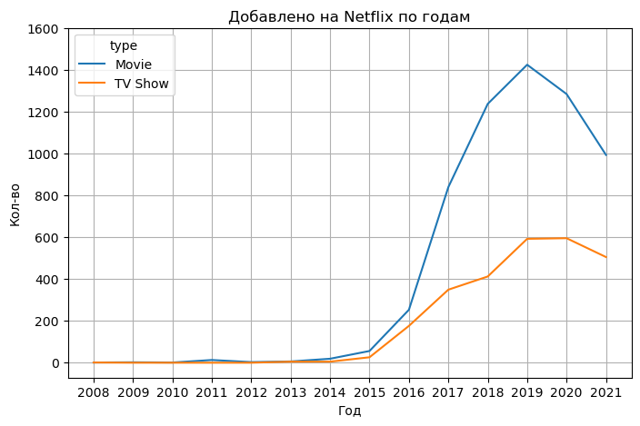

# Анализ данных Netflix

Пет-проект по анализу данных на Python (pandas): ответы на вопросы о составе каталога Netflix и проверка качества данных. 
Данные: открытый датасет Netflix Movies and TV Shows (Kaggle), 8807 фильмов и сериалов. 
Сделан после изучения pandas, чтобы потренироваться на реальных данных. 
Вопросы к данным просила сгенерировать нейросеть (из всех предложенных выбрала четыре). 

## Что умеет
Ноутбук отвечает на четыре вопроса:
1. Как менялось число добавленных фильмов и сериалов по годам.
2. Какие страны дают больше всего контента (отдельно для фильмов и сериалов).
3. Какие жанры самые частые.
4. Сколько в данных пропусков и как они влияют на выводы.

К каждому вопросу есть график/таблица и короткий вывод, в конце ноутбука общий вывод.

## Как запустить
Требуется Python 3 (или Anaconda). Библиотеки: pandas, matplotlib, jupyter (список в `requirements.txt`).

1. Скачайте репозиторий (Code -> Download ZIP) и распакуйте. Файл `netflix_titles.csv` уже лежит рядом с ноутбуком
2. Один раз установите библиотеки:

       python -m pip install -r requirements.txt

3. Запуск одной командой:

       python -m jupyter notebook netflix_analysis.ipynb

4. В ноутбуке выберите Kernel -> Restart Kernel and Run All Cells

Без запуска: результаты видны в `netflix_analysis.ipynb`

## Пример результата
